<div align="center">

# 🎓 Repositori Dokumen KP & TA
### Mahasiswa D3 Teknik Informatika UKSW

Aplikasi web untuk membantu proses **pengelolaan, pengumpulan, dan pemantauan** dokumen Kerja Praktik (KP) dan Tugas Akhir (TA) mahasiswa.

<br>


</div>

---

## 📑 Daftar Isi

- [Project Overview](#-project-overview)
- [Features](#-features)
- [Tech Stack](#-tech-stack)
- [Screenshots](#-screenshots)
- [Database](#-database)
- [Testing](#-testing)
- [My Contribution](#-my-contribution)
- [What I Learned](#-what-i-learned)
- [Installation](#-installation)
- [Project Status](#-project-status)

---

## 🎯 Project Overview

Project ini dikembangkan untuk meningkatkan efisiensi dalam proses pengumpulan dan pengelolaan dokumen Tugas Akhir (TA) dan Kerja Praktik (KP). Sistem menyediakan berbagai fitur yang membantu mahasiswa dan dosen D3 Teknik Informatika UKSW dalam mengelola dokumen akademik secara lebih terstruktur dan efisien.

### 🏁 Tujuan

- 📥 Mempermudah mahasiswa D3 Teknik Informatika UKSW dalam mengumpulkan dokumen TA dan KP.
- 👩‍🏫 Membantu dosen dalam mengelola dan memantau dokumen TA dan KP mahasiswa.
- ✅ Mempermudah proses pengecekan dokumen serta pemantauan status pengumpulan dokumen.

---

## ✨ Features

| Fitur | Deskripsi |
| :-- | :-- |
| 🔐 **Authentication & Login** | Masuk sesuai hak akses (User atau Admin) |
| 📤 **Pengumpulan Dokumen** | Form pengumpulan dokumen KP dan TA |
| 📝 **Status Revisi** | Mahasiswa dapat mengirim ulang dokumen saat diminta revisi |
| 🔔 **Notifikasi** | Pemberitahuan saat status atau catatan dokumen berubah |
| 🕘 **History / Riwayat Submission** | Pemantauan progres dokumen: Terkumpul, Revisi, Disetujui |
| 🗂️ **Pengelolaan Dokumen** | Admin melihat, mencari, mengunduh, dan menghapus dokumen |
| ✅ **Approval Dokumen** | Admin mengubah status dan menambahkan catatan |
| 📆 **Automatic Semester Detection** | Data dikelompokkan otomatis berdasarkan semester berjalan |
| 👥 **Pengelolaan Pengguna** | Admin mencari, mengedit, dan menghapus user |

---

## 🧰 Tech Stack

| Kategori | Teknologi |
| :-- | :-- |
| **Backend** | PHP, Laravel |
| **Frontend** | HTML, CSS, Bootstrap, JavaScript |
| **Database** | MySQL |
| **Tools** | Visual Studio Code, XAMPP, phpMyAdmin, Git & GitHub |

---

## 🖼️ Screenshots

<details open>
<summary><b>👤 Guest</b></summary>

<br>

#### Landing Page

<p align="center">
  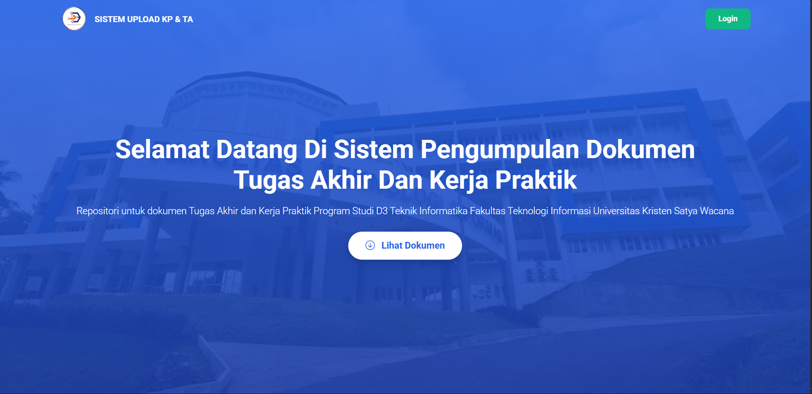
</p>

> Tampilan awal website yang menyediakan akses login ke sistem dan melihat dokumen abstrak yang sudah disetujui.

#### Daftar File Abstrak KP dan TA

<p align="center">
  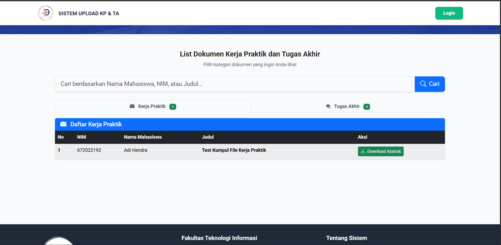
</p>

> Halaman lanjutan dari Landing Page yang menampilkan daftar file abstrak TA dan KP mahasiswa yang sudah disetujui.

#### Login

<p align="center">
  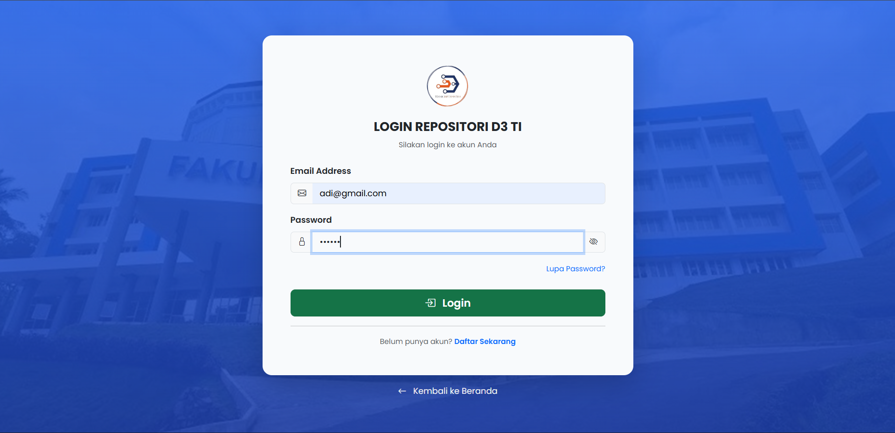
</p>

> Digunakan untuk masuk ke sistem sebagai User (mahasiswa) atau Admin (dosen) sesuai hak akses masing-masing.

</details>

<details>
<summary><b>🎓 User (Mahasiswa)</b></summary>

<br>

#### Homepage

<p align="center">
  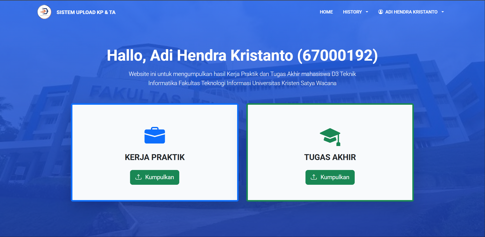
</p>

> Tampilan awal setelah User berhasil login. User dapat memilih jenis dokumen yang akan dikumpulkan, yaitu Kerja Praktik (KP) atau Tugas Akhir (TA).

#### Form Pengumpulan Dokumen

<p align="center">
  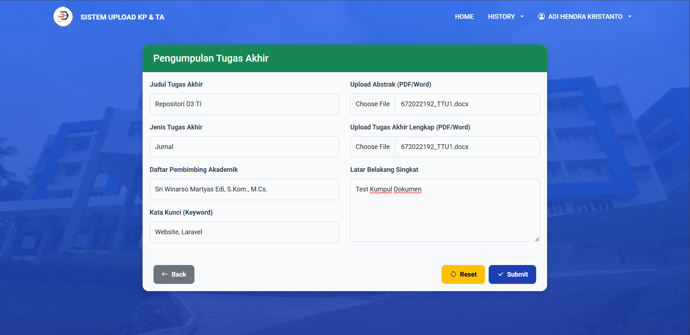
</p>

> Digunakan untuk mengisi data terkait dokumen yang akan dikumpulkan. Formulir TA dan KP memiliki struktur yang serupa.

#### History Dokumen

Halaman untuk melihat aktivitas User maupun Admin terkait dokumen yang sudah dikumpulkan. Terdapat 3 status untuk menginformasikan progres dokumen:

| 🟡 Terkumpul | 🟠 Revisi | 🟢 Disetujui |
| :-: | :-: | :-: |
| 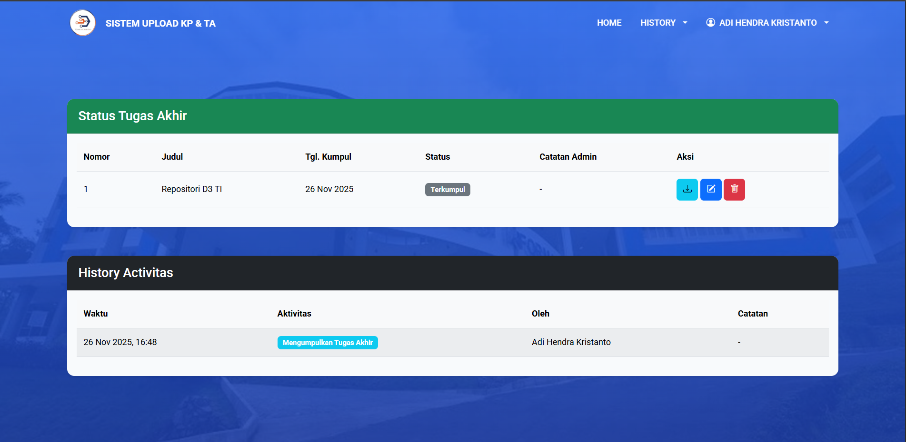 | 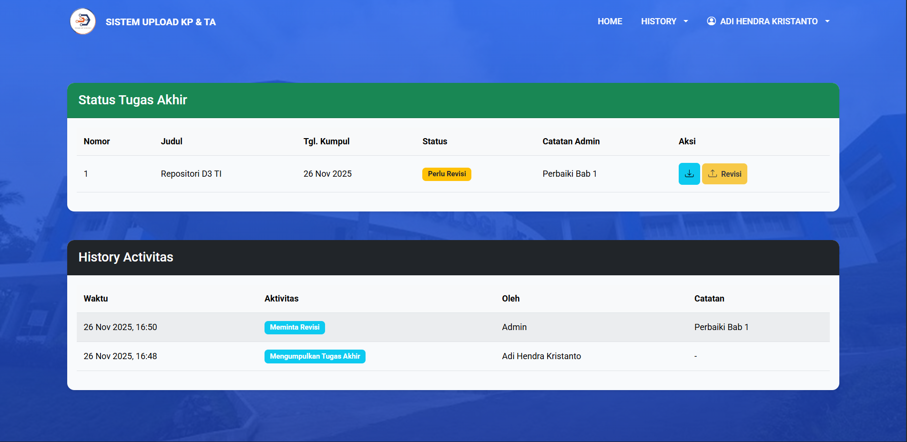 | 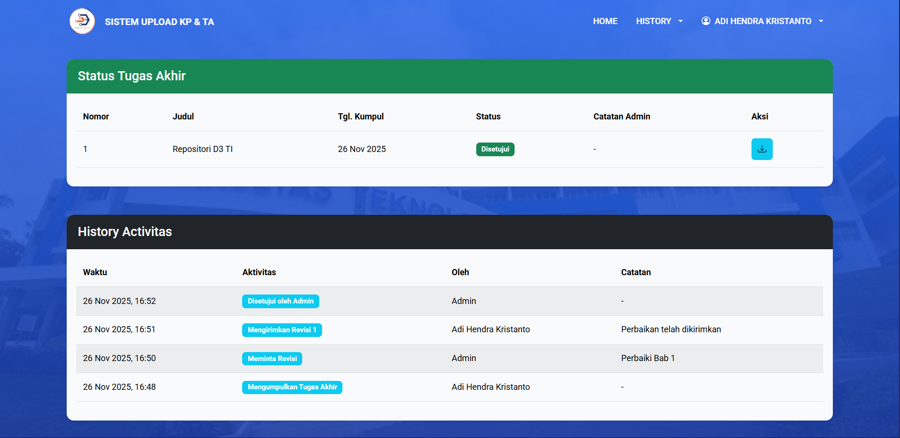 |

#### Form Revisi Dokumen

<p align="center">
  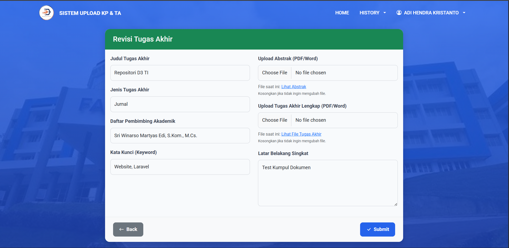
</p>

> Digunakan untuk mengirim kembali dokumen atau mengubah data jika terdapat revisi.

#### Dropdown Notification

<p align="center">
  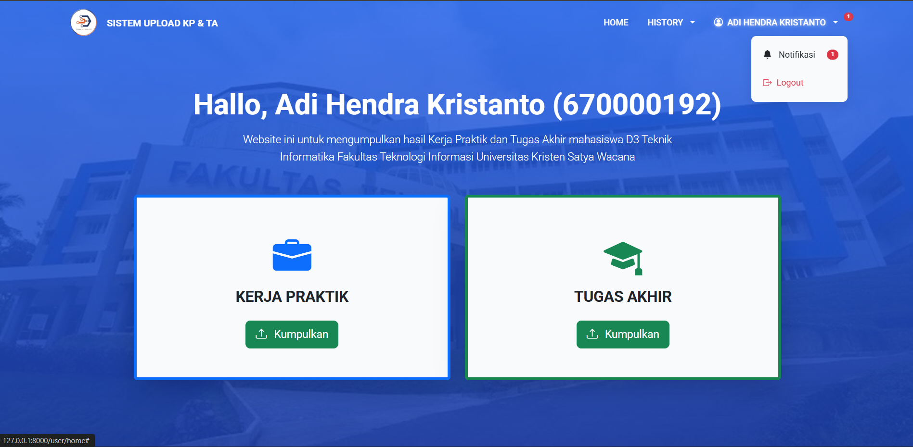
</p>

> Tampilan ketika admin sudah mengubah status atau memberikan catatan untuk dokumen yang dikumpulkan mahasiswa.

#### Notification

<p align="center">
  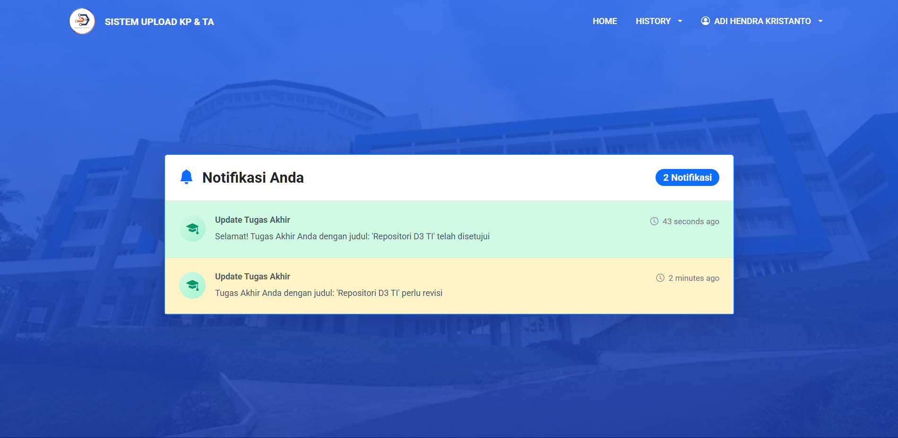
</p>

> Digunakan untuk melihat daftar notifikasi yang diterima User.

</details>

<details>
<summary><b>🛡️ Admin (Dosen)</b></summary>

<br>

#### Dashboard

<p align="center">
  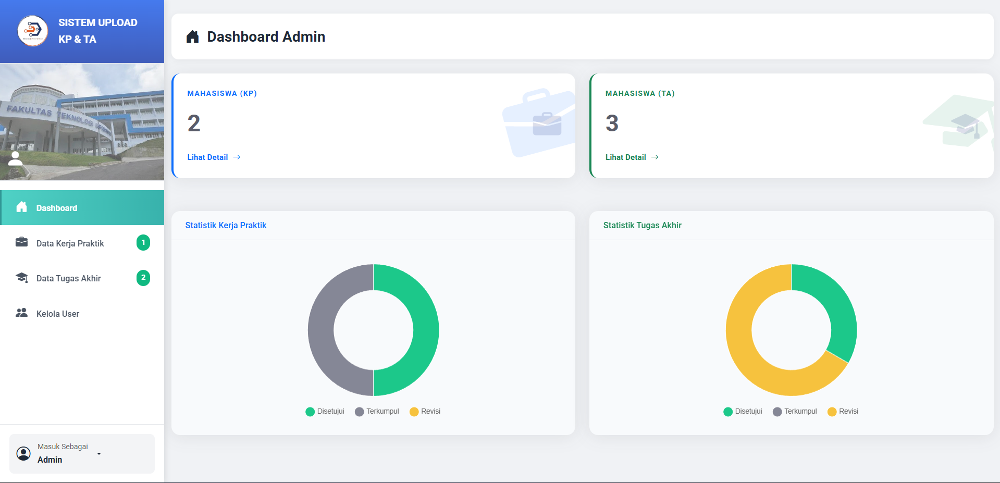
</p>

> Menampilkan jumlah dan statistik dokumen yang telah dikumpulkan mahasiswa untuk membantu admin memantau proses pengumpulan.

#### Detail Mahasiswa Semester Ini

<p align="center">
  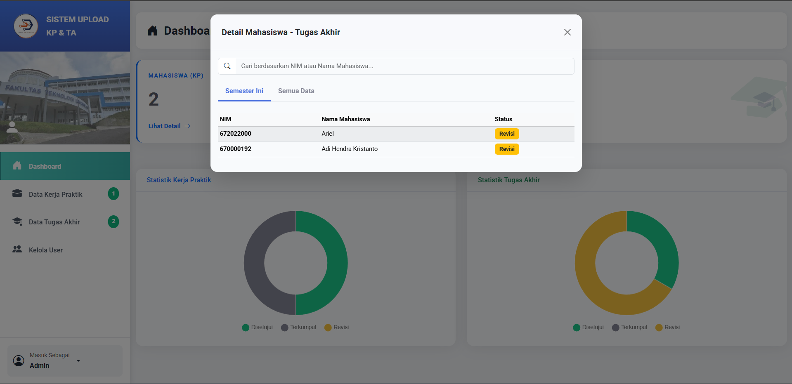
</p>

> Menampilkan daftar mahasiswa yang sudah mengumpulkan dokumen pada semester berjalan.

#### Detail Mahasiswa Semua Semester

<p align="center">
  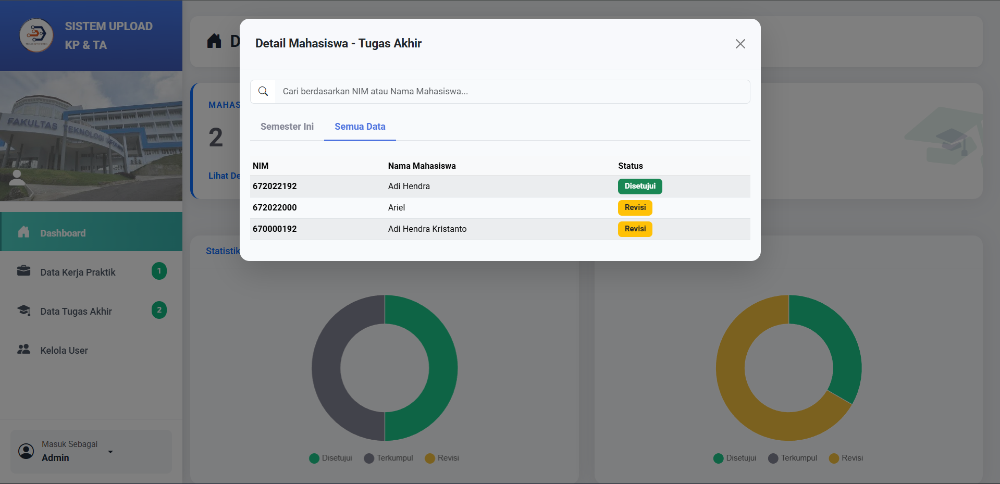
</p>

> Menampilkan daftar mahasiswa yang telah mengumpulkan dokumen tanpa dibatasi periode atau semester tertentu.

#### Daftar Data Dokumen Mahasiswa

<p align="center">
  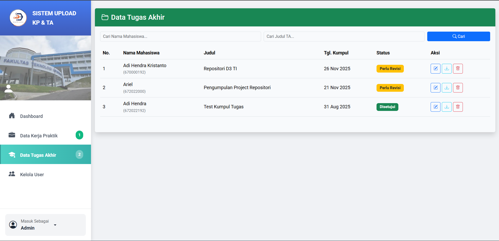
</p>

> Menampilkan daftar dokumen mahasiswa yang sudah dikumpulkan, dilengkapi fitur pencarian.

#### Detail Dokumen Mahasiswa

<p align="center">
  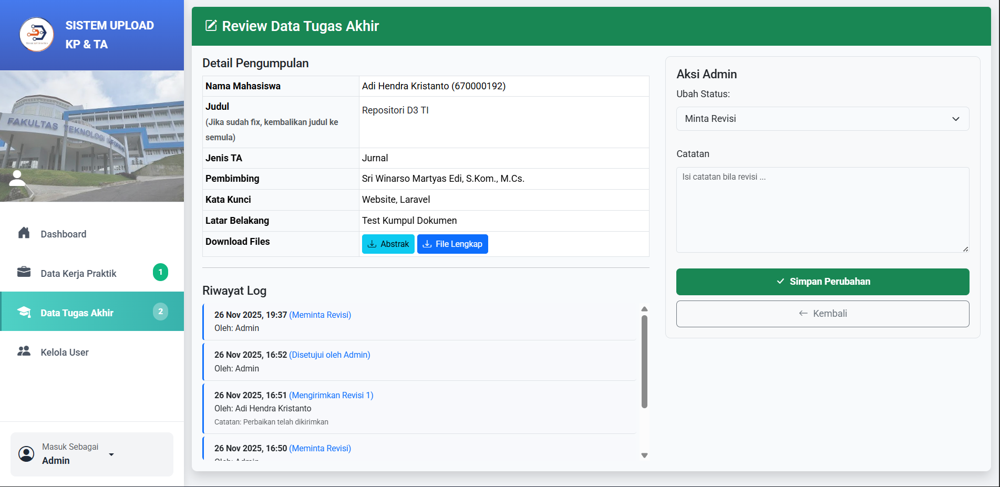
</p>

> Menampilkan detail dokumen mahasiswa. Admin dapat mengubah status dan menambahkan catatan pada dokumen.

#### Kelola User

<p align="center">
  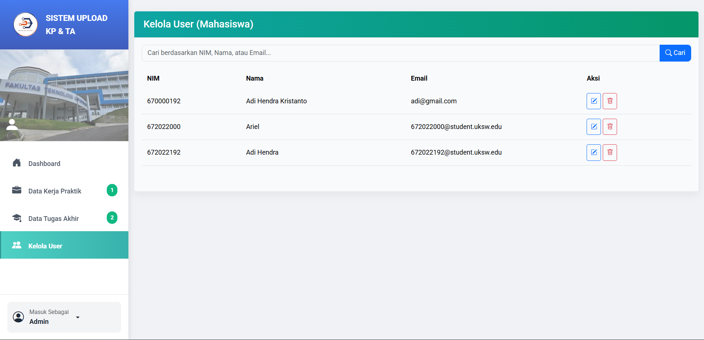
</p>

> Digunakan untuk mengelola data User. Admin dapat mencari, mengedit, dan menghapus User.

</details>

---

## 🗄️ Database

Project ini menggunakan **MySQL** sebagai database.

### Entity Relationship Diagram

<p align="center">
  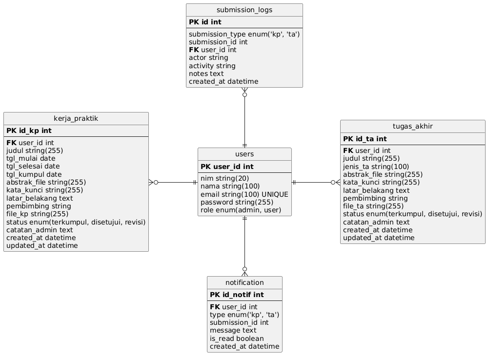
</p>

### Database Structure

| Table | Description |
| :-- | :-- |
| `users` | Menyimpan data pengguna |
| `kerja_pratik` | Menyimpan data pengumpulan dokumen kerja praktik |
| `tugas_akhir` | Menyimpan data pengumpulan dokumen tugas akhir |
| `notification` | Mengelola notifikasi terkait aktivitas dan perubahan status dokumen |
| `submission_log` | Mencatat riwayat aktivitas pengumpulan dokumen KP/TA |

---

## 🧪 Testing

Pengujian sistem dilakukan menggunakan metode **Black Box Testing** untuk memastikan fitur-fitur yang tersedia berjalan sesuai dengan kebutuhan sistem.

<details>
<summary><b>👤 Black Box Testing – Guest</b> (7 pengujian ✅)</summary>

<br>

| No. | Fitur yang Diuji | Hasil Pengujian | Status |
| :-: | :-- | :-- | :-: |
| 1 | List data file abstrak | Data abstrak berhasil ditampilkan | ✅ Berhasil |
| 2 | Unduh file abstrak | File abstrak berhasil diunduh | ✅ Berhasil |
| 3 | Login | User berhasil masuk sesuai hak akses | ✅ Berhasil |
| 4 | Validasi login | Sistem menampilkan peringatan ketika email/password tidak sesuai | ✅ Berhasil |
| 5 | Registrasi | Data pengguna berhasil disimpan | ✅ Berhasil |
| 6 | Validasi registrasi | Sistem memberikan peringatan ketika form tidak lengkap | ✅ Berhasil |
| 7 | Lupa password | Link reset password berhasil dikirim ke email | ✅ Berhasil |

</details>

<details>
<summary><b>🎓 Black Box Testing – User (Mahasiswa)</b> (11 pengujian ✅)</summary>

<br>

| No. | Fitur yang Diuji | Hasil Pengujian | Status |
| :-: | :-- | :-- | :-: |
| 1 | Pengumpulan dokumen TA/KP | Form pengumpulan berhasil ditampilkan | ✅ Berhasil |
| 2 | Submit dokumen TA/KP | Data pengumpulan berhasil disimpan | ✅ Berhasil |
| 3 | Validasi form pengumpulan | Form tidak dapat disubmit jika belum lengkap | ✅ Berhasil |
| 4 | Validasi ukuran file | Sistem menolak file yang melebihi batas ukuran | ✅ Berhasil |
| 5 | History TA/KP | Halaman history berhasil ditampilkan | ✅ Berhasil |
| 6 | Melihat aktivitas dokumen | Data dokumen dan riwayat aktivitas berhasil ditampilkan | ✅ Berhasil |
| 7 | Edit dokumen | Dokumen dengan status "Terkumpul" dapat diedit | ✅ Berhasil |
| 8 | Hapus dokumen | Dokumen dengan status "Terkumpul" dapat dihapus | ✅ Berhasil |
| 9 | Revisi dokumen | Halaman revisi berhasil ditampilkan ketika status "Revisi" | ✅ Berhasil |
| 10 | Notifikasi | Halaman notifikasi berhasil ditampilkan | ✅ Berhasil |
| 11 | Detail notifikasi | Notifikasi mengarahkan user ke history TA/KP terkait | ✅ Berhasil |

</details>

<details>
<summary><b>🛡️ Black Box Testing – Admin</b> (11 pengujian ✅)</summary>

<br>

| No. | Fitur yang Diuji | Hasil Pengujian | Status |
| :-: | :-- | :-- | :-: |
| 1 | Dashboard | Jumlah dokumen TA/KP berhasil ditampilkan | ✅ Berhasil |
| 2 | Daftar mahasiswa | Data mahasiswa yang telah mengumpulkan dokumen berhasil ditampilkan | ✅ Berhasil |
| 3 | Filter "Semester Ini" | Data mahasiswa sesuai periode semester berhasil ditampilkan | ✅ Berhasil |
| 4 | Data TA/KP | Daftar dokumen TA/KP berhasil ditampilkan | ✅ Berhasil |
| 5 | Hapus dokumen TA/KP | Dokumen berhasil dihapus | ✅ Berhasil |
| 6 | Unduh dokumen TA/KP | Dokumen berhasil diunduh | ✅ Berhasil |
| 7 | Review dokumen | Halaman review dokumen berhasil ditampilkan | ✅ Berhasil |
| 8 | Perubahan status dokumen | Status dokumen berhasil diperbarui | ✅ Berhasil |
| 9 | Kelola user | Daftar user yang telah terdaftar berhasil ditampilkan | ✅ Berhasil |
| 10 | Edit user | Data user berhasil diperbarui | ✅ Berhasil |
| 11 | Hapus user | User berhasil dihapus | ✅ Berhasil |

</details>

---

## 🛠️ My Contribution

- 🗃️ Merancang database
- ⚙️ Mengembangkan backend menggunakan Laravel
- 🎨 Mengembangkan frontend
- 🔐 Membuat authentication
- 📤 Mengembangkan fitur pengumpulan dokumen
- 📆 Mengembangkan fitur Automatic Semester Detection
- ✅ Mengembangkan fitur approval/revisi
- 🧪 Melakukan testing

---

## 📚 What I Learned

- Pengembangan aplikasi web menggunakan Laravel
- Konsep MVC
- Perancangan dan pengelolaan database relasional
- Authentication dan authorization
- Pengelolaan file/dokumen
- Database migration
- Git dan GitHub
- Software testing menggunakan Black Box Testing

---

## 🚀 Installation

> [!NOTE]
> Pastikan **PHP**, **Composer**, dan **XAMPP** (MySQL) sudah terpasang.

**1. Clone repository**

```bash
git clone https://github.com/Hendro08/repositori_kp_ta.git
cd repositori_kp_ta
```

**2. Install dependency Laravel**

```bash
composer install
```

**3. Salin `.env.example` menjadi `.env`**

```bash
cp .env.example .env
```

**4. Buat database baru** melalui phpMyAdmin.

**5. Atur konfigurasi database** pada file `.env`

```env
DB_DATABASE=nama_database
DB_USERNAME=root
DB_PASSWORD=
```

**6. Generate application key**

```bash
php artisan key:generate
```

**7. Jalankan migration dan seeder**

```bash
php artisan migrate --seed
```

**8. Jalankan aplikasi**

```bash
php artisan serve
```

**9. Buka aplikasi** melalui <http://127.0.0.1:8000>

---

## 📌 Project Status


Project ini telah selesai dikembangkan dan digunakan sebagai bagian dari portfolio.